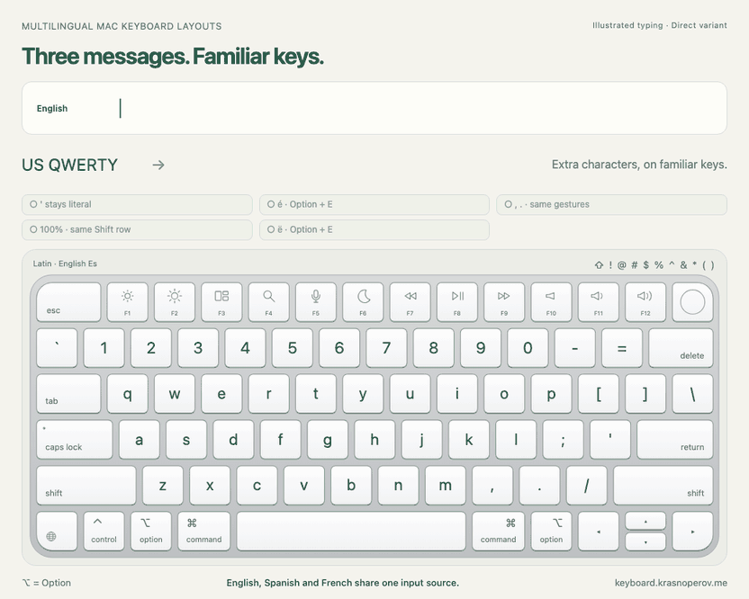

# Multilingual Mac Keyboard Layouts

**Keep your QWERTY habits. Add the characters you need.**

You type English and Spanish on a US keyboard, then switch to Russian to reply
to a message. The letters are familiar. The comma suddenly isn't.

On Apple's **Russian** layout, comma and period are Shift+6 and Shift+7.
On **U.S.**, they have their own keys. Russian–PC uses yet another arrangement.
The same punctuation mark needs a different gesture depending on the language.

The goal is fewer things to keep track of:

- **Stay in one Latin source** for English, Spanish, Catalan, Portuguese, French
  and Italian. Add accents and extra letters through Option.
- **Keep shared gestures when switching to Russian.** The US number row stays
  `1234567890` / `!@#$%^&*()`. Option+comma types `,` and Option+period types `.`
  in either source.

These are native macOS layouts for a US QWERTY keyboard. No background app is
needed. Option punctuation adds a modifier in English; the tradeoff is one gesture
you can use in both scripts.

**[Try the interactive keyboard](https://keyboard.krasnoperov.me)** ·
[Watch the full typing video](https://keyboard.krasnoperov.me/typing-demo/) ·
[Download the layouts](https://github.com/krasnoperov/macos-multilingual-layouts/releases/tag/v1.0.0)

The animations illustrate output from the actual layout XML. The Latin languages
share one source; Globe appears only before Russian. Its milestones mark
literal apostrophes, accents, common punctuation and unchanged Shift symbols.

## Use the example, or make it yours

### Install a ready-made layout

| Variant | Best fit | Example |
|---|---|---|
| **Direct input** | Frequent Spanish accents in one chord | Option+E → é |
| **Dead keys** | Familiar Mac accent composition | Option+E, release, then E → é |

Both variants include ç, æ/œ, Catalan · and additional accent families. Both keep
the same Russian layout, shared punctuation and US number row. Direct also has
supplementary dead keys: its name does not mean every character is one chord.
[Full key guide](docs/key-guide.md).

1. Download and unzip **one** variant from the [release](https://github.com/krasnoperov/macos-multilingual-layouts/releases/tag/v1.0.0).
2. Copy its `.bundle` into `~/Library/Keyboard Layouts/`.
3. Log out and back in.
4. Add **English Es** and **Russian Es** in System Settings → Keyboard → Text Input.

The Latin source is named English Es even when you write French or another
supported language. If updating, back up the old bundle **outside** Keyboard
Layouts and remove the installed copy before replacing it. Install only one
variant, in one location. [Installation and macOS settings](docs/macos-settings.md)
cover shortcuts, ABC, duplicate sources and the optional cursor indicator.

### Ask an agent to adapt it

Your languages and habits may call for different choices. Give an agent this prompt:

> Hey agent, look at how this keyboard types accents and punctuation:
> https://keyboard.krasnoperov.me/typing-demo/
>
> Help me make a native macOS layout for my languages and habits. Use this skill:
> https://github.com/krasnoperov/macos-multilingual-layouts/tree/main/skills/design-macos-keyboard-layouts
>
> First ask which keyboard, languages, apps and shortcuts I use, and what keeps
> interrupting me. Keep the positions I already know, make shared symbols
> consistent, and suggest direct input or dead keys where they fit. Then help me
> install it with a backup and test real typing in my apps.

The [skill](skills/design-macos-keyboard-layouts/SKILL.md) guides the interview,
XML edits, installation and verification. The layouts here are a worked example,
not a preset everyone must adopt. [Design reasoning](docs/design-with-an-llm.md).

Native translation checks cover both variants, accent composition and shortcuts;
manual acceptance is recorded separately. [Test scope](docs/testing.md) ·
[Sources and acknowledgments](docs/references.md) · [Asset provenance](docs/provenance.md).

## Questions and Answers

### Why bother if macOS already types accents?

It does: [Apple documents dead keys and the accent menu](https://support.apple.com/guide/mac-help/mh27474/mac).
This project changes the gestures to suit a particular workflow: direct Spanish
vowels, explicit extra-letter bindings and shared punctuation with Russian.
If the built-in layout already fits your habits, you may not need this one.

### Why not US International or EurKEY?

Those are valid alternatives. US International behavior varies by platform;
compare the exact layout you use, rather than its name alone.
[EurKEY](https://github.com/felixfoertsch/EurKEY-Next) is another QWERTY-based
multilingual choice. Our example focuses on the listed languages and matching
Latin/Cyrillic punctuation gestures. The reusable skill lets you choose a different
balance instead of adapting yourself to someone else's mapping.

### Do I have to relearn where the letters are?

English stays US QWERTY; Russian keeps its familiar letter positions. You learn
additional Option gestures. Some US punctuation positions hold Cyrillic letters,
so comma and period use the shared Option layer; they are not identical plain
keystrokes in both sources.

### Are apostrophes and quotes dead keys now?

No. Ordinary apostrophes, quotes, grave and tilde remain literal when typed
normally. Accent composition starts with Option combinations, leaving everyday
English and code punctuation alone.

### Why are there two versions?

Direct keeps á/é/í/ó/ú/ñ/ü immediately accessible. Dead Keys retains classic Mac
accent sequences. Both have the same supplementary bindings, such as Option+K
for circumflex, Option+W for tilde and Option+S/M for æ/œ. Choose the habit you
prefer; install one version.

### Didn't making a layout require Ukelele?

The usual workflow meant installing an editor such as
[Ukelele](https://software.sil.org/ukelele/) and changing the layers by hand.
**Thank you to SIL and the Ukelele authors** for the editor and the work behind
this ecosystem. Native `.keylayout` files have always been editable XML; now an
agent can help adapt a reference layout quickly through a conversation. Ukelele
remains a useful editor and inspection tool, but is not required for this workflow.

### Can the agent make it fit me instead?

Yes—that is what the skill is for. It should ask about your languages, physical
keyboard, frequent symbols and apps, then propose a small set of changes. You can
keep only one language, move an inconvenient accent or favor dead keys. The agent
should back up the installation, check the structure and guide actual typing
tests; generated XML alone is not proof that your apps behave correctly.
